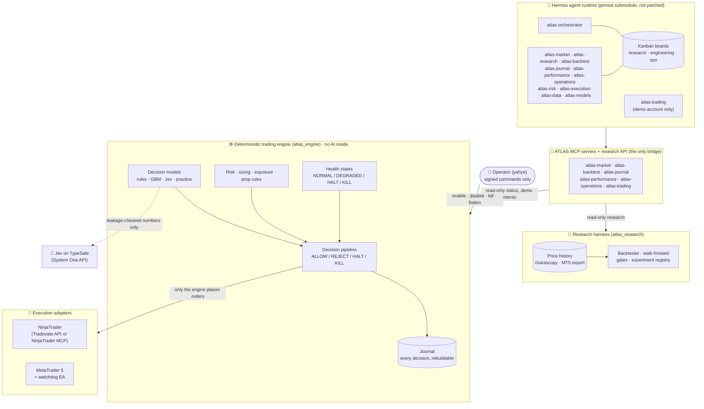
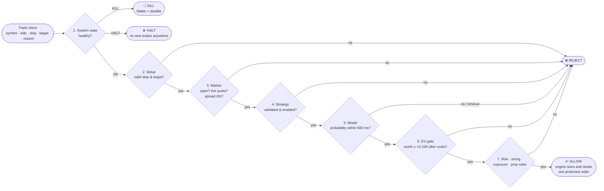
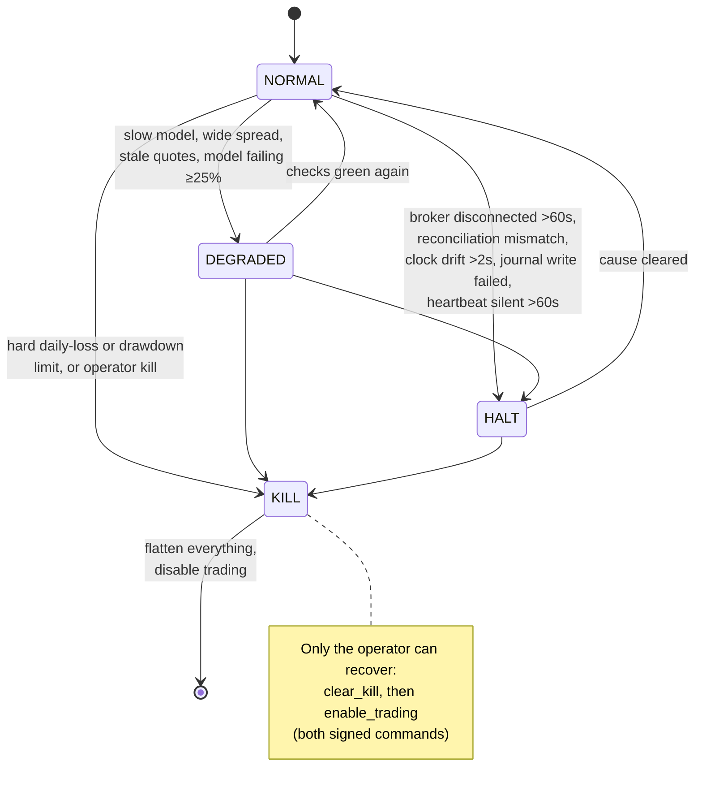
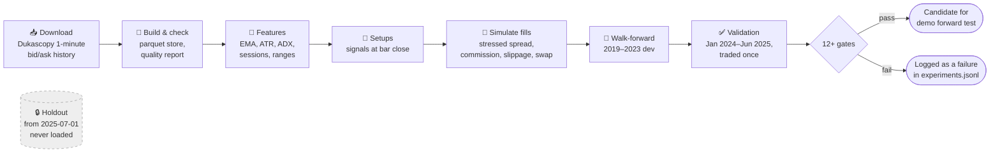

# ATLAS

**Autonomous Trading Intelligence & Learning System**

A research lab and a safety-first trading engine for futures and forex, with a team of AI agents (built on the
Hermes agent runtime) that research strategies, watch the system and, on a practice account only, propose
trades of their own.


-8A2BE2)

> [!IMPORTANT]
> **ATLAS has not found a strategy that makes money yet.** Every strategy tested so far, on forex and on
> futures, failed its tests after trading costs. ATLAS is wired so that it **cannot trade real money**: the
> engine trades only a strategy that passed every test (none has), and AI agents may only ever trade a
> **demo** (simulated-money) account. See [Honest results](#-honest-results-so-far).

> [!TIP]
> This page is long on purpose. Every ▶ heading below folds open when you click it, and the
> [table of contents](#contents) jumps straight to a section. New to trading words? The
> [glossary](#-glossary-trading-words-in-plain-language) explains every one used here.

---

## Contents

| | Section | What you'll learn |
| --- | --- | --- |
| 1 | [ATLAS in one minute](#-atlas-in-one-minute) | What it is, in plain words |
| 2 | [The big picture](#-the-big-picture) | A diagram of every part and how they connect |
| 3 | [How one trade is decided](#-how-one-trade-is-decided) | The ALLOW / REJECT / HALT / KILL pipeline |
| 4 | [The system's moods](#-the-systems-moods-normal-degraded-halt-kill) | NORMAL, DEGRADED, HALT and KILL |
| 5 | [How strategies are researched](#-how-strategies-are-researched) | Data, backtests, the gates a strategy must pass |
| 6 | [Honest results so far](#-honest-results-so-far) | Every round of tests and what it found |
| 7 | [The tech stack, piece by piece](#-the-tech-stack-piece-by-piece) | Hermes, the engine, Jev, NinjaTrader, MT5, data... |
| 8 | [The AI team (personas)](#-the-ai-team-personas) | The twelve Hermes agents and what each may touch |
| 9 | [Safety rules](#-safety-rules) | Why no agent can trade real money |
| 10 | [Repository map](#-repository-map) | Which folder holds what |
| 11 | [Install, run and test](#-install-run-and-test) | Commands to try it yourself |
| 12 | [Configuration](#-configuration) | The config files and who may change them |
| 13 | [Where things stand](#-where-things-stand) | Built, tested on stand-ins, not built yet |
| 14 | [Glossary](#-glossary-trading-words-in-plain-language) | Trading words in plain language |
| 15 | [Further reading](#-further-reading) | The design documents in `docs/` |

---

## 🧭 ATLAS in one minute

Think of ATLAS as three things working together:

1. **A research lab.** It downloads years of real price history, replays strategies against it (a
   *backtest*), charges every realistic cost, and only calls a strategy good if it survives a long list of
   strict tests decided *before* the test runs. So far nothing has survived.
2. **A strict, rule-following trading engine.** Ordinary Python code, no AI inside, that takes a trade idea
   from anywhere and says yes or no through a fixed checklist: is the system healthy, is the market open, is
   the trade worth its cost, is the risk inside the limits? It alone sizes trades and talks to the broker.
3. **A team of AI agents** (Hermes "personas") that do research chores, review results, watch the system and
   raise alerts. One of them, `atlas-trading`, may propose its own trades, but only on a demo account, and
   only through the same engine checklist as everything else.

The golden rule, from the design: **agents can propose, the engine decides, the operator (yahye) enables.**

<details>
<summary><b>▶ What does "futures-first" mean here?</b></summary>

ATLAS started as a forex system (currency pairs like EURUSD through MetaTrader 5 and the prop firm FTMO).
On 2026-10-05 the owner moved it to **futures first**: small CME stock-index futures such as MES (Micro
E-mini S&P 500) and MNQ (Micro E-mini Nasdaq-100), through a prop firm (FundedNext Futures as the worked
example), with **NinjaTrader** as the main platform since 2026-10-06. The forex path still works and is
still tested. See [`docs/futures.md`](docs/futures.md).

</details>

---

## 🗺️ The big picture



**How to read it:** the agents at the top never touch the broker. Everything they do goes through the MCP
servers in the middle, which only expose read-only research tools, read-only status, and (for
`atlas-trading`) a "propose a demo trade" tool. Only the engine places orders, and only the operator can
switch trading on.

<details>
<summary><b>▶ Why two separate runtimes?</b></summary>

| Runtime | What runs there | Language | Can it trade? |
| --- | --- | --- | --- |
| **Hermes** (agents) | Personas, memory, skills, Kanban, chat bots, scheduled jobs | Python (upstream Hermes) | No. It can only call ATLAS MCP tools. |
| **ATLAS engine** | Decision pipeline, risk, sizing, broker adapters, journal, health, kill switch | Python (`atlas_engine`, `atlas_api`) | Yes, and it is the only thing that can. |

Keeping them apart means a confused or misbehaving AI agent cannot skip the risk checks: the code that
would place an order isn't reachable from the agent side at all. Tests in
[`tests/engine/test_v3_boundaries.py`](tests/engine/test_v3_boundaries.py) fail the build if anything outside
the engine host imports an order path.

</details>

---

## 🚦 How one trade is decided

Every trade idea, whether it comes from a rule-based strategy or from the Hermes trader, becomes one
**trade intent** ([`atlas_engine/intents.py`](atlas_engine/intents.py)) and goes through the same
**decision pipeline** ([`atlas_engine/pipeline.py`](atlas_engine/pipeline.py)). The first stage that fails
decides the outcome, and every stage is written to the journal.



<details>
<summary><b>▶ The EV gate in plain words</b></summary>

"EV" means *expected value*: on average, what is this trade worth? ATLAS measures it in **R** (one R is the
amount risked on the trade):

```
EV_R = p × R_target − (1 − p) − C_R    and it must be ≥ +0.15R
```

- `p` is the chance the target is hit before the stop, from the decision model.
- `R_target` is how far the target is compared with the stop (a 2R target pays twice the risk).
- `C_R` is the trading cost (commission plus an optional slippage allowance) as a share of the risk.

Example: a 2R target needs a stated chance of about 40% or better to pass. The threshold lives in config
(`decision.ev_min_r`); no model or agent can change it. Code: [`atlas_engine/decisions/ev.py`](atlas_engine/decisions/ev.py).

</details>

<details>
<summary><b>▶ What a trade intent may <i>not</i> contain</b></summary>

An intent that tries to set any of these is rejected whole ([`atlas_engine/intents.py`](atlas_engine/intents.py)):
position size, risk, exposure, any override, credentials, or raw broker order fields (`orderQty`,
`contractId`, `accountId`, brackets...). Missing fields are never filled in by guessing. The engine sizes
every trade itself: `contracts = floor(allowed risk / (stop ticks × tick value + fees))`, capped by the
prop firm's contract limit.

</details>

<details>
<summary><b>▶ The decision models (rules, GBM, Jev, practice, agent-stated)</b></summary>

All models share one interface, `evaluate_setup(setup, state) → estimate or failure`
([`atlas_engine/models/`](atlas_engine/models/)), and every call is wrapped in `SafeModel`, which enforces a
hard 500 ms timeout and turns any crash, bad answer, NaN probability or unpinned version into a REJECT.

| Model | Where the probability comes from | Status |
| --- | --- | --- |
| `rules` | The strategy's validated out-of-sample hit rate | Default. No strategy has a validated hit rate yet. |
| `gbm` | A gradient-boosted model trained in research (T2) | Built, research only |
| `jev` | TypeSafe's Jev model over leakage-checked numbers | Client built; demo-only until calibrated |
| `practice` | A fixed figure for the demo machinery test | Demo account only |
| agent-stated | The probability Hermes states for its own trade | Demo account only |

</details>

---

## 🌡️ The system's moods: NORMAL, DEGRADED, HALT, KILL

The engine checks its own health every step ([`atlas_engine/ops/health.py`](atlas_engine/ops/health.py))
and is always in exactly one of four states.



| State | What it means | What the engine does |
| --- | --- | --- |
| 🟢 **NORMAL** | All checks green | Trades normally |
| 🟡 **DEGRADED** | Something is off for one market | No new trades on that market |
| 🟠 **HALT** | Something is wrong with the system | No new trades anywhere, alerts the operator |
| 🔴 **KILL** | A hard loss limit was hit, or the operator pressed kill | Closes every ATLAS position, cancels pending orders, switches trading off |

---

## 🔬 How strategies are researched



The rules that keep research honest:

- **Declare before you test.** Each round's strategies, settings grid, costs and pass marks are committed
  to git *before* any data is loaded. Results can't quietly move the goalposts.
- **Count every try.** Every run, pass or fail, is appended to
  [`research/experiments.jsonl`](research/experiments.jsonl) and never edited. The "deflated Sharpe" gate
  uses that count, so trying many variants makes passing harder, as it should.
- **Same code as live.** Research and the live engine build features and signals with the same modules.
- **The holdout stays locked.** Data from 2025-07-01 on is held back for one final check. Research code and
  the `atlas-backtest` server both refuse to load it.

<details>
<summary><b>▶ The gates a strategy must pass (T0)</b></summary>

| Gate | Pass mark |
| --- | --- |
| Out-of-sample trades | ≥ 300 |
| Average result after costs (1.5× spread) | ≥ +0.10R, on dev **and** validation |
| Profit factor | ≥ 1.25, on dev **and** validation |
| Monte Carlo max drawdown (p95, 10,000 reshuffles) | < 60% of the firm's limit |
| Chance of breaching the daily loss limit in an evaluation | < 2% |
| Deflated Sharpe ratio (every recorded trial counted) | > 0.95 |
| Walk-forward efficiency | ≥ 50% |
| Average result at 2× spread | > 0 |
| Largest single year's share of profit | ≤ 40% |
| Skip-10% Monte Carlo, 5th percentile | > 0 |
| Beats random entries (p95) | > 0 |
| Worst ±20% parameter neighbour | > 0 |

Details: [`docs/t0-edge-discovery.md`](docs/t0-edge-discovery.md). Later research phases add exit research
(T1, [`docs/t1-exit-research.md`](docs/t1-exit-research.md)), a selection layer comparing rules vs GBM vs
Jev (T2, [`docs/t2-selection-layer.md`](docs/t2-selection-layer.md)) and a prop-firm Monte Carlo through the
risk engine (T3, [`docs/t3-risk-and-sizing.md`](docs/t3-risk-and-sizing.md)).

</details>

<details>
<summary><b>▶ The strategy ideas ("setups") in the code</b></summary>

All in [`atlas_engine/setups/`](atlas_engine/setups/), used by both research and the live engine:

| Setup | The idea in one line |
| --- | --- |
| `trend_pullback` | In an uptrend, buy a dip once price turns back up (and the reverse) |
| `session_breakout` | Trade a break of the range set before a session opens |
| `liquidity_sweep` | Fade a quick poke beyond a recent high or low that snaps back |
| `channel_breakout` | Buy a close above the highest high of the last N bars (and the reverse) |
| `usd_seasonality` | Time-of-day patterns in the US dollar |
| `opening_range_breakout` | Trade a 15-minute close outside the first 15–30 minutes after the New York open |
| `opening_gap` | Trade the gap between yesterday's close and today's open |
| `intraday_momentum` | Follow the morning's direction late in the day |
| `overnight_drift` | Hold through the overnight session |

Extra research-only setups live in [`atlas_research/research_setups.py`](atlas_research/research_setups.py)
(for example the Nasdaq "noise area" band).

</details>

---

## 📊 Honest results so far

> [!WARNING]
> **No strategy has passed.** The numbers below are the average result per trade in R, after costs, out of
> sample. A negative number means the strategy lost money.

<details open>
<summary><b>▶ Forex (EURUSD, GBPUSD), real Dukascopy data 2019 to mid-2025</b></summary>

Twelve strategies over seven rounds ([`docs/t0-edge-discovery.md`](docs/t0-edge-discovery.md)).

| Round | Strategy | Out-of-sample trades | After costs |
| --- | --- | --- | --- |
| 1 (M15) | Liquidity sweep | 460 | −0.107R |
| 1 (M15) | Trend pullback | 1,675 | −0.300R |
| 1 (M15) | Session breakout | 1,599 | −0.280R |
| 2 (H1) | Liquidity sweep / trend pullback / session breakout | 258 / 400 / 724 | −0.083R / −0.112R / −0.085R |
| 3 | Channel breakout (H4) | 610 | −0.097R |
| 3 | USD seasonality (H1) | 2,853 | −0.049R |
| 7 | Channel breakout with trend exits | 388 | −0.107R |

Rounds 4–6 (fix reversal, swing trend, carry trend) are on a separate branch (PR #12) and also failed. The
main lesson: costs were about 0.23R a trade at 15-minute stop sizes, and the setups did no better than random
entries before costs.

</details>

<details>
<summary><b>▶ Futures (MES, MNQ), proxied by Dukascopy index CFD data</b></summary>

There is no futures price history in the repo, so the S&P 500 and Nasdaq-100 cash-index CFDs stand in for
MES and MNQ, re-quoted at the future's one-tick spread.

| Round | Market | What was tested | Verdict |
| --- | --- | --- | --- |
| MES 1 | S&P 500 | Opening-range breakout, H4 channel breakout, H1 trend pullback | None passed |
| MES 2 | S&P 500 | Four more strategies | None passed |
| MES 3 | S&P 500 | Long-only H4 breakout on independent 2013–2018 data | Failed 4 of 5 rules |
| MNQ 1 | Nasdaq-100 | Five candidates from an evidence review | None passed (noise area best, +0.023R) |
| MNQ 2 | Nasdaq-100 | Noise area with a volatility stop | Failed validation; frozen version passed a 2018 check |
| MNQ 3 | Nasdaq-100 | Two frozen versions on 2013–2017 | Both failed: the edge seen in 2018–2023 wasn't there in 2014–2017 |

Write-ups: [`docs/mes-candidates.md`](docs/mes-candidates.md), [`docs/mnq-candidates.md`](docs/mnq-candidates.md).

</details>

<details>
<summary><b>▶ The demo practice run (machinery test, not a profit test)</b></summary>

To prove the plumbing works end to end, ATLAS is set up to trade 1 MES on NinjaTrader's free simulated
$50,000 account, using the opening-range breakout. That strategy **lost 0.012R a trade in its backtest** and
is used only because it trades often and simply. It passes if, over at least 20 trades, no position is ever
left without a stop, every order matches the journal, and slippage stays within 2 ticks. Losing money does
not fail it. Runbook: [`docs/demo-practice.md`](docs/demo-practice.md).

</details>

---

## 🧱 The tech stack, piece by piece

<details>
<summary><b>▶ 🐍 Python and its libraries</b></summary>

| Item | Used for |
| --- | --- |
| Python ≥ 3.11 | Everything ATLAS adds |
| `numpy`, `pandas`, `scipy` | Bars, features, backtests, statistics (Monte Carlo, deflated Sharpe) |
| `pyarrow` | Parquet files for the 1-minute price store |
| `pyyaml` | Every config file |
| `mcp` 2.0.0 (extra `mcp`) | The ATLAS MCP servers; same pin as Hermes |
| `scikit-learn` (extra `selection`) | The T2 gradient-boosted baseline (research only) |
| `websocket-client` (extra `ninjatrader`) | Live NinjaTrader/Tradovate quotes on the engine host |
| `pytest` (extra `dev`) | The test suite |
| `setuptools` | Packaging; console commands in [`pyproject.toml`](pyproject.toml) |

</details>

<details>
<summary><b>▶ 🤖 Hermes, the agent runtime (pinned submodule)</b></summary>

[Hermes](https://github.com/NousResearch/hermes-agent) by Nous Research is an open-source agent operating
system: personas (profiles), memory, skills, MCP tools, delegation, Kanban boards, chat gateways
(Telegram, Discord, Slack), scheduled jobs and a web dashboard. ATLAS reuses all of that instead of building
its own agent framework.

- It lives at `vendor/hermes-agent`, **pinned to v2026.9.21** (`d337b736`). ATLAS never patches it; ATLAS
  code loads from outside it.
- [`docs/hermes-h0-checklist.md`](docs/hermes-h0-checklist.md) audits the 21 Hermes capabilities ATLAS relies on.
- [`deploy/hermes/bootstrap.py`](deploy/hermes/bootstrap.py) installs every ATLAS profile, its model, its
  boards, its MCP tokens and the scheduled jobs.
- Models per tier ([`deploy/hermes/models.yaml`](deploy/hermes/models.yaml)): frontier, mid and cheap tiers
  map to Anthropic models by default, and any persona can name its own provider (OpenAI, Gemini, a local
  model...).
- [`atlas_plugins/`](atlas_plugins/) is the ATLAS Hermes plugin: audit and alert hooks, scheduled-job
  helpers and an ATLAS tab for the Hermes dashboard.
- [`atlas-skills/`](atlas-skills/) holds eleven step-by-step skills (backtest analysis, data quality, demo
  trading, exit research, risk review, incident triage...).
- [`deploy/hermes/cron.yaml`](deploy/hermes/cron.yaml) schedules jobs such as the health check, alert relay,
  reconciliation report, daily report and the hourly demo trading session.

</details>

<details>
<summary><b>▶ ⚙️ The deterministic engine (<code>atlas_engine</code>)</b></summary>

"Deterministic" means the same inputs always give the same answer: plain code, no AI.

| Part | Folder | Job |
| --- | --- | --- |
| Trade intents | `intents.py`, `agent_intents.py` | One proposal format; Hermes's extra limits (4 intents a day, 2 open, demo only) |
| Pipeline and runtime | `pipeline.py`, `runtime.py` | The stage-by-stage decision and the engine loop |
| Decisions | `decisions/` | The EV gate and the normalised market state (regime labels) |
| Models | `models/`, `calibration/` | Rules, GBM, Jev, practice; isotonic calibration |
| Risk | `risk/`, `sizing/`, `exposure/`, `prop_rules/` | Per-trade risk, daily and drawdown stops, contract or lot sizing, currency netting, prop-firm rules as data |
| Futures | `futures/` | Contracts (MES, NQ, ...), roll dates, CME Globex hours in Chicago time |
| Market data | `market_data/`, `features/` | Dukascopy and MT5 importers, bar store, quality checks, shared indicators |
| Execution | `execution/`, `adapters/` | One `ExecutionBroker` interface; NinjaTrader, MT5 and Jev adapters |
| Safety | `ops/health.py`, `reconciliation/`, `alerts/` | Health states, matching the journal against the broker, alert outbox |
| Journal | `journal/` | Every decision, order and fill in SQLite; `atlas-engine audit <id>` rebuilds a trade from it alone |
| Operator | `operator.py` | Signed commands: enable trading, kill, clear kill, flatten, re-enable after a drawdown stop |

</details>

<details>
<summary><b>▶ 🧠 Jev and TypeSafe</b></summary>

Jev is a non-generative "System One" model from TypeSafe AI: it takes text or JSON and answers typed
questions with probabilities. ATLAS asks it one yes/no question ("will price reach the target before the
stop?") and one choice question (which of six regime labels fits), over **numbers only**: no dates, prices,
symbols or news, so it can't recognise a moment in history it may have seen.

- Client: [`atlas_engine/adapters/jev/typesafe.py`](atlas_engine/adapters/jev/typesafe.py), calling
  `POST /v1/systemone`. Questions and thresholds: [`atlas_engine/adapters/jev/questions.py`](atlas_engine/adapters/jev/questions.py).
- The model is pinned (`jev-1.13.0`); answers from any other version are refused.
- The key comes only from `TYPESAFE_API_KEY` on the engine host (or a proxy that adds it).
- A slow answer, error or rate limit is a REJECT, never a retry.
- Without a fitted calibration file, Jev may only trade a demo account.
- On this branch no strategy has been evaluated through Jev; Jev filter tests are in separate draft PRs.

</details>

<details>
<summary><b>▶ 🏦 NinjaTrader (primary) and the broker adapter</b></summary>

NinjaTrader's official API is the Tradovate API, so one adapter serves both names
([`atlas_engine/adapters/ninjatrader/`](atlas_engine/adapters/ninjatrader/)). There are two routes:

| Route | Code | Use | How sure we are |
| --- | --- | --- | --- |
| Tradovate API | `client.py`, `adapter.py`, `quotes.py` | A funded or evaluation account (needs API access) | **Tested on a stand-in only.** FundedNext API access is unconfirmed. |
| NinjaTrader MCP server | `mcp.py`, `mcp_venue.py` | NinjaTrader's free demo account | Sign-in, account, quotes and history checked against the **real demo server**. Placing and cancelling orders **rehearsed on a stand-in only**. |

Every entry goes out as one bracket (entry, stop and target together). The adapter then checks the
protection really exists at the platform and HALTs if it can't confirm it. Real answers captured from the
demo server are in [`docs/ninjatrader-mcp-capture/`](docs/ninjatrader-mcp-capture/).

</details>

<details>
<summary><b>▶ 💱 MetaTrader 5 and the watchdog EA (forex path)</b></summary>

- [`atlas_engine/adapters/mt5/`](atlas_engine/adapters/mt5/) wraps the MetaTrader 5 terminal (Windows
  only), with a fake terminal for tests.
- [`watchdog/AtlasWatchdog.mq5`](watchdog/AtlasWatchdog.mq5) is an Expert Advisor that runs inside MT5,
  independent of Python: it flattens the account at its own hard equity lines and writes a heartbeat the
  engine watches. **Not compiled yet** (MetaEditor is Windows-only).
- The planned demo run on a Windows VPS is still owed ([`docs/t4-engine-and-mt5.md`](docs/t4-engine-and-mt5.md)).

</details>

<details>
<summary><b>▶ 🔌 The ATLAS MCP servers and API</b></summary>

MCP (Model Context Protocol) is how AI agents call tools. ATLAS runs six servers
([`atlas_mcp/servers.py`](atlas_mcp/servers.py)), each issuing tools only to the personas allowed to use
them, with scoped tokens ([`atlas_mcp/scopes.py`](atlas_mcp/scopes.py)):

| Server | Offers | Command |
| --- | --- | --- |
| `atlas-market` | Market state, bars, spread stats | `atlas-mcp-market` |
| `atlas-backtest` | Backtests, walk-forward, exit research, Monte Carlo (refuses the holdout) | `atlas-mcp-backtest` |
| `atlas-journal` | Trade queries, MFE/MAE, loss clusters | `atlas-mcp-journal` |
| `atlas-performance` | Performance summary | `atlas-mcp-performance` |
| `atlas-operations` | Read-only engine status and health; `disable_trading` | `atlas-mcp-operations` |
| `atlas-trading` | Demo trade intents, own positions, track record | `atlas-mcp-trading` |

Behind them sit the research API (`atlas-api`, [`atlas_api/http.py`](atlas_api/http.py)) and the engine's
operations and trading routes ([`atlas_api/ops.py`](atlas_api/ops.py), [`atlas_api/trading.py`](atlas_api/trading.py)).
No server can enable trading or change risk.

</details>

<details>
<summary><b>▶ 📥 Data sources</b></summary>

| Source | What | Code |
| --- | --- | --- |
| **Dukascopy** | Free 1-minute bid/ask history for forex and index CFDs (the futures proxy) | [`atlas_engine/market_data/dukascopy.py`](atlas_engine/market_data/dukascopy.py) |
| **MT5 "Export bars"** | A broker's own bars, as an alternative | [`atlas_engine/market_data/mt5_csv.py`](atlas_engine/market_data/mt5_csv.py) |
| **NinjaTrader / Tradovate** | Live quotes and recent bars on the engine host | `atlas_engine/adapters/ninjatrader/` |
| **Synthetic data** | Made-up prices for dry runs, refused by the real experiment registry | [`atlas_engine/market_data/synthetic.py`](atlas_engine/market_data/synthetic.py) |

Downloaded data goes under `data/` and is never committed.

</details>

<details>
<summary><b>▶ 🖥️ Deployment pieces</b></summary>

| Path | What |
| --- | --- |
| `deploy/hermes/systemd/` | Services for the engine API and the Hermes gateways |
| `deploy/hermes/egress/` | A Squid proxy allowlist so agents reach only approved hosts |
| `deploy/demo-practice/` | Config and service for the NinjaTrader demo practice run |
| `deploy/futures-config/` | An example FundedNext Flex 50K config (for the operator to review and sign) |

</details>

---

## 👥 The AI team (personas)

Each persona is a Hermes profile in [`atlas-profiles/`](atlas-profiles/) with its own personality file
(`SOUL.md`), model tier, tools and skills. The full list of what each may call is in
[`atlas-profiles/roster.yaml`](atlas-profiles/roster.yaml).

| Persona | Model tier | Job | Can it trade? |
| --- | --- | --- | --- |
| `atlas-orchestrator` | frontier | Runs the Kanban boards, talks to the operator on Telegram | No |
| `atlas-market` | cheap | Reads market state and spreads | No |
| `atlas-research` | mid | Proposes and runs research experiments | No |
| `atlas-backtest` | mid | Builds and checks backtests | No |
| `atlas-journal` | cheap | Reads the trade journal | No |
| `atlas-performance` | cheap | Summarises results | No |
| `atlas-operations` | cheap | Watches health, can switch trading **off** (never on) | No |
| `atlas-risk` | mid | Reviews risk, read only | No |
| `atlas-execution` | mid | Engineering on execution code | No |
| `atlas-data` | cheap | Data quality and pipelines | No |
| `atlas-models` | mid | Model and calibration work | No |
| `atlas-trading` | frontier | Proposes its own trades | **Demo account only**, no size, own trades only |

<details>
<summary><b>▶ How the Hermes trader is scored</b></summary>

Every closed trade is scored in R after costs. With fewer than 100 trades the verdict is `too_early`. It
becomes `passing` only with an average of at least +0.10R and the low end of its 95% range above zero, and
`losing` if the high end is below zero. Its stated confidence is checked against what actually happened
(Brier score). `atlas-engine scorecard` prints it. Nothing here can promote it to a live account. Details:
[`docs/hermes-trader.md`](docs/hermes-trader.md).

</details>

---

## 🛡️ Safety rules

These come from [`AGENTS.md`](AGENTS.md) and the PRD, and most are enforced by tests, not just promises.

| Rule | How it's enforced |
| --- | --- |
| No agent places live trades, changes risk or enables trading | No MCP tool exists for it; boundary tests fail the build if an order path leaks |
| Agents trade only a demo account | Engine refuses any agent intent unless the broker reports a demo account, and raises a critical alert |
| Only the engine sizes trades | Size fields in an intent reject it |
| Every trade carries a stop and target at the broker | The adapter verifies the bracket and HALTs if it can't |
| Risk and prop-firm config change only by a signed operator commit | Config loader refuses a config the engine could write to; agents never edit `config/` |
| The holdout data is never loaded | Research code and the `atlas-backtest` server refuse it (HTTP 403) |
| Credentials stay on the engine host | Tests fail if a profile or skill mentions them |
| A chat reply never authorises anything | Enabling, kill and flatten are signed operator commands only |
| Every experiment is reported, failures included, in R after costs | Append-only `research/experiments.jsonl` |

---

## 📁 Repository map

<details>
<summary><b>▶ Click to see the folder tree</b></summary>

```text
ATLAS/
├── ATLAS_PRD.md                    # Governing design (v3, Oct 2026)
├── ATLAS_v3_Hermes_Derived_PRD.md  # Earlier detailed design; code cites it as "PRD §N"
├── AGENTS.md                       # Rules for AI agents working in this repo
├── pyproject.toml                  # Package, dependencies, console commands
├── atlas_engine/                   # The deterministic trading engine
├── atlas_research/                 # Backtests, walk-forward, gates, research CLI
│   └── configs/                    # Declared research rounds (t0, t1, t2, mes, mnq)
├── atlas_api/                      # Research API, engine operations API, engine CLI
├── atlas_mcp/                      # The six ATLAS MCP servers and their scopes
├── atlas_plugins/                  # The ATLAS Hermes plugin (hooks, jobs, dashboard)
├── atlas-profiles/                 # One Hermes profile per persona + roster.yaml
├── atlas-skills/                   # Step-by-step skills for the personas
├── config/                         # Live config: operator-signed changes only
├── deploy/                         # Hermes bootstrap, services, egress proxy, example configs
├── docs/                           # Design and results write-ups
├── research/experiments.jsonl      # Every experiment ever run, append-only
├── tests/                          # engine, research, mcp, ops, hermes
├── watchdog/AtlasWatchdog.mq5      # MT5 backstop EA
└── vendor/hermes-agent/            # Hermes, pinned submodule (never patched)
```

</details>

---

## 🚀 Install, run and test

### Install

```bash
git clone --recurse-submodules https://github.com/yahyeameer/ATLAS.git
cd ATLAS
python3 -m venv .venv && . .venv/bin/activate
pip install -e '.[dev]'              # add ,ninjatrader for the live quote feed
```

### Run the tests

```bash
python -m pytest -q
```

> [!NOTE]
> In a fresh cloud checkout without the Hermes submodule installed, 1,300 tests pass, 4 skip, and 2
> dashboard tests in `tests/ops/test_dashboard.py` fail: one needs Hermes importable, the other needs the
> dashboard's built `dist/index.js`, which the repo's `.gitignore` (`dist/`) keeps out of git.

<details>
<summary><b>▶ Try the research harness without downloading anything</b></summary>

```bash
atlas-research data synthetic --data-root /tmp/syn
atlas-research t0 run --all --data-root /tmp/syn --registry /tmp/syn/exp.jsonl --out /tmp/syn/runs
```

Synthetic runs are refused against the real registry, so they never count as trials.

</details>

<details>
<summary><b>▶ Run a real research round</b></summary>

```bash
atlas-research data download --symbols EURUSD GBPUSD   # 2019-01-01 .. 2025-06-30, resumable
atlas-research data build    --symbols EURUSD GBPUSD   # -> data/m1/<SYMBOL>/<YEAR>.parquet
atlas-research data quality  --symbols EURUSD GBPUSD   # gaps, crossed quotes, spread stats
atlas-research t0 run --all                            # -> research/runs/<experiment_id>/report.md
```

Other commands: `atlas-research t0 check` (a frozen-parameter check), `t1 run` (exit research),
`t2 run` (rules vs GBM), `prop-mc` (prop-firm evaluation Monte Carlo), `data import-mt5`.

</details>

<details>
<summary><b>▶ Engine commands (<code>atlas-engine</code>)</b></summary>

| Command | What it does |
| --- | --- |
| `atlas-engine run --broker ...` | Run the engine loop and serve its operations API |
| `atlas-engine operator keygen / enable_trading / kill / clear_kill / flatten / reenable_drawdown` | Signed operator commands |
| `atlas-engine token` | Issue an engine API token for a persona |
| `atlas-engine show` | Is it trading, is anything wrong |
| `atlas-engine audit <decision_id>` | Rebuild one decision and its trade from the journal |
| `atlas-engine scorecard` | Closed trades in R by setup, and Hermes's verdict |
| `atlas-engine practice-report` | The demo practice run's report card |
| `atlas-engine ninjatrader-mcp login / check / capture / preflight` | Sign in to the NinjaTrader demo, check it, save its read-only answers |
| `atlas-engine-sim` | A simulated engine for operations testing |

The full demo walkthrough, step by step, is [`docs/demo-practice.md`](docs/demo-practice.md).

</details>

<details>
<summary><b>▶ Install the Hermes side</b></summary>

```bash
pip install -e '.[mcp]'
python deploy/hermes/bootstrap.py --hermes <path to hermes> \
    --engine-url http://127.0.0.1:8742 --engine-tokens <engine-tokens.yaml>
```

Then start the gateways in `deploy/hermes/systemd/`. A model API key (for example `ANTHROPIC_API_KEY`) goes
in the service environment, never in a config file. See [`docs/h1-profiles-and-boards.md`](docs/h1-profiles-and-boards.md).

</details>

---

## 🔧 Configuration

| File | What it controls | Who may change it |
| --- | --- | --- |
| `config/atlas.yaml` | Symbols, platform, decision thresholds (EV, model timeout, Jev pin) | Operator, by signed commit |
| `config/risk.yaml` | Risk per trade, daily and drawdown stops, exposure, trades per day | Operator, by signed commit |
| `config/prop_rules/*.yaml` | The prop firm's rules as data | Operator, by signed commit |
| `config/strategies/*.yaml` | Which strategies may trade and their validated hit rate (none exist yet) | Operator, by signed commit |
| `atlas_research/configs/*.yaml` | Declared research rounds | Committed before each round runs |
| `deploy/hermes/models.yaml` | Which AI model each persona uses | Operator |
| `atlas-profiles/roster.yaml` | Each persona's tools, boards and skills | Operator |

<details>
<summary><b>▶ Example: the <code>decision:</code> block</b></summary>

```yaml
decision:
  ev_min_r: 0.15          # minimum expected value after costs
  model_timeout_ms: 500   # a model slower than this is a REJECT
  min_target_r: 0.5
  max_target_r: 10.0
  max_spread_to_stop: 0.20
  extra_cost_r: 0.0       # slippage allowance added to costs
  jev_model: jev-1.13.0   # pinned; aliases like jev-latest are refused
```

</details>

---

## 📍 Where things stand

| Area | Status |
| --- | --- |
| Hermes profiles, boards, MCP servers, skills, ops plugin | ✅ Built and tested offline |
| Decision pipeline, models, EV gate, risk engine, journal, audit | ✅ Built and tested |
| Futures contracts, sessions, prop rules as data, contract sizing | ✅ Built and tested |
| NinjaTrader MCP route (free demo) | 🟡 Sign-in and reading checked on the real demo server; orders on a stand-in only |
| NinjaTrader / Tradovate API route | 🟡 Tested on a stand-in only; FundedNext API access unconfirmed |
| Jev client | 🟡 Built; demo-only until a calibration is fitted |
| MT5 adapter | 🟡 Tested on a fake terminal; Windows VPS demo run still owed |
| MT5 watchdog EA | 🟡 Written, not compiled |
| A strategy that passes every gate | ❌ None yet |
| Economic-calendar news blackout | ❌ Not built (needs a calendar feed) |
| Paper-vs-backtest drift check | ❌ Not built (needs paper trades) |
| Live trading | ❌ Not built, by design, until a strategy passes every gate |

---

## 📖 Glossary: trading words in plain language

<details open>
<summary><b>▶ Click to fold</b></summary>

| Word | Meaning |
| --- | --- |
| **Backtest** | Replaying a strategy on past prices to see how it would have done |
| **Bid / ask** | The price you can sell at / buy at. The ask is a little higher. |
| **Spread** | The gap between bid and ask; a cost paid on every trade |
| **Commission** | The broker's fee per trade |
| **Slippage** | Getting filled at a worse price than planned |
| **Swap** | The overnight fee for holding a forex position |
| **R** | One unit of risk: what you lose if the stop is hit. +2R = won twice what was risked. |
| **Expectancy** | The average result per trade, in R |
| **Stop (stop-loss)** | A price where the trade is closed to cap the loss |
| **Target (take-profit)** | A price where the trade is closed to bank the gain |
| **Bracket order** | An entry sent together with its stop and target |
| **Long / short** | Betting the price goes up / goes down |
| **Flatten** | Close every open position |
| **Futures** | Contracts on an index or commodity traded on an exchange like CME |
| **MES / MNQ** | Micro E-mini S&P 500 ($5 per point) and Micro E-mini Nasdaq-100 ($2 per point) |
| **Tick** | The smallest price step. MES: 0.25 points = $1.25. |
| **Contract roll** | Moving from an expiring contract (e.g. MESZ6, December 2026) to the next (MESH7) |
| **Forex / EURUSD** | Currency trading; EURUSD is the euro priced in US dollars |
| **CFD** | A dealer's contract that tracks a price; used here as stand-in history for futures |
| **Prop firm** | A company that funds traders who pass its evaluation, under strict loss rules |
| **Drawdown** | How far the account has fallen from its peak |
| **Daily loss limit** | The most the firm lets you lose in one day before the account fails |
| **Demo account** | A practice account with simulated money |
| **Profit factor** | Total gains ÷ total losses. Above 1 means it made money. |
| **Walk-forward** | Tune on one period, test on the next, repeat, so tests are always on unseen data |
| **Out-of-sample (OOS)** | Data the strategy wasn't tuned on |
| **Holdout** | Data locked away for one final test, never used during research |
| **Monte Carlo** | Reshuffling trades thousands of times to see the range of possible outcomes |
| **Sharpe ratio / deflated Sharpe** | Return per unit of risk; the deflated version is penalised for how many ideas were tried |
| **Calibration / Brier score** | Whether "60% sure" really comes true about 60% of the time |
| **Regime** | The market's current character: trending or ranging, calm or volatile |
| **ATR / EMA / ADX** | Common indicators: average range, a smoothed average price, trend strength |
| **Opening range** | The high and low of the first minutes after the market opens |
| **Reconciliation** | Checking the journal against what the broker says is open |
| **EA (Expert Advisor)** | A program that runs inside MetaTrader |

</details>

---

## 📚 Further reading

| Document | About |
| --- | --- |
| [`ATLAS_PRD.md`](ATLAS_PRD.md) | The governing design (v3) |
| [`docs/v3-architecture.md`](docs/v3-architecture.md) | How each design section maps onto this repo |
| [`docs/futures.md`](docs/futures.md) | Futures-first, NinjaTrader, FundedNext, what's verified |
| [`docs/demo-practice.md`](docs/demo-practice.md) | Runbook for the NinjaTrader demo practice run |
| [`docs/hermes-trader.md`](docs/hermes-trader.md) | Hermes trading the demo account |
| [`docs/t0-edge-discovery.md`](docs/t0-edge-discovery.md) | Forex research rounds and gates |
| [`docs/mes-candidates.md`](docs/mes-candidates.md), [`docs/mnq-candidates.md`](docs/mnq-candidates.md) | Futures research rounds |
| [`docs/t1-exit-research.md`](docs/t1-exit-research.md) … [`docs/t4-engine-and-mt5.md`](docs/t4-engine-and-mt5.md) | Exits, selection layer, risk and sizing, engine and MT5 |
| [`docs/h1-profiles-and-boards.md`](docs/h1-profiles-and-boards.md), [`docs/h2-mcp-and-skills.md`](docs/h2-mcp-and-skills.md), [`docs/h3-ops-integration.md`](docs/h3-ops-integration.md) | Hermes setup phases |
| [`docs/hermes-h0-checklist.md`](docs/hermes-h0-checklist.md) | Audit of the Hermes capabilities ATLAS uses |
| [`docs/open-questions-decisions.md`](docs/open-questions-decisions.md) | Early decisions (partly superseded by futures-first) |
